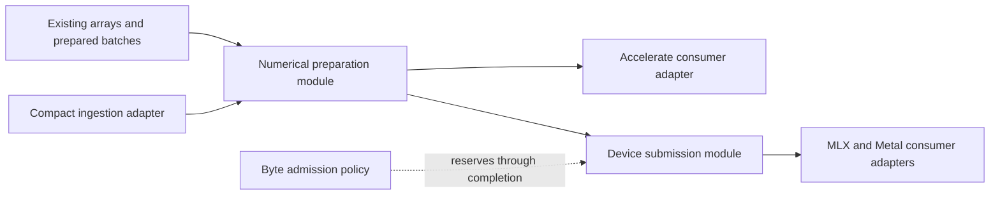

# Apple silicon memory prototype design review

Date: 2026-10-04. Status: research and proposed next experiments. No production storage change or new performance claim.

Reviewed SwiftSci commit `aa5c71968c080f4188357c4cb628389f89ca00a2` on `codex/unified-memory-prototype`. Qualified dependency source is mlx-swift 0.32.3, `19601207e9a0de51e03ee6ec0c3c5f3784275075`, with MLX core submodule `1f8e74e3f12f31365464a6867c6579f0e9b29d85`. A separate stale `.build` checkout was excluded from dependency conclusions. Source locations below refer to these revisions, not whatever code happens to accompany this notes branch later.

## Decision proposed

Continue with retained columnar snapshots and consumer-specific preparation. Deepen the numerical-preparation module so callers describe required values, row selection, layout, missing-value behavior and precision. Its implementation should own allocation, gathering, conversion and lifetime rules. Keep device submission as a separate module because asynchronous completion imposes different ownership rules from a synchronous CPU borrow.

The prototype supports this direction, but has gaps in its interface and allocation policy. The largest opportunities are eliminating redundant memory traffic, preparing the actual consumer representation once, and bounding retained memory while CPU and GPU work overlap. Merely replacing every allocation with a Metal buffer would leave several existing copies and correctness obligations intact.

This proposal refines the [October 1 integration plan](2026-10-01-memory-integration.md). Historical measurements remain in the [experiment sequence](2026-10-01-memory-sequence.md). The former managed-owner leak is fixed in the qualified 0.32.3 wrapper. The separate [runtime numerical regression](2026-10-04-mlx-regression-source.md) still limits broader dependency adoption; the [context-validation correction](2026-10-04-context-validation-fix.md) addresses our own construction defect.

## Constraints and supported workflows

The scientific workflow is observations, selection and stable sorting, training-only preprocessing, matrix preparation, numerical solve, and held-out prediction. The device workflow prepares a typed batch, submits computation, allows independent host work, and consumes results after completion. Both must retain row identity, missing-value semantics and snapshots. Sharing storage must not silently narrow Double to Float or change the requested reduction policy.

The current package declares Swift tools 6.0 and macOS 14. These are compatibility constraints, not an Intel requirement. Newer Swift features should be qualified against compiler, standard-library availability and deployment independently. The proposal does not require raising the minimum version for its first CPU contribution. Public `TypedColumn.values` and existing model entry points can remain compatible while internal consumers move to prepared inputs.

## Source observations and design gaps

### 1. Keep values, validity and selection together

`SelectedTable` retains complete `Column` values, including their validity owners, and checks row indices. That is the right snapshot structure. `ReadLease`, however, retains only a value owner. Its generic `withBuffer<R>` permits a pointer to escape as the return value. The pipeline separately proves that selected rows are non-null before borrowing raw payloads. Correctness therefore depends on facts spread between the caller and storage implementation.

Evidence: `Benchmarks/UnifiedMemoryPrototype/Storage.swift:64-78`, `80-159`; `Pipeline.swift:106-107`, `180-184`, `201-217`.

Keep value-only leases private. The numerical-preparation interface should retain a snapshot containing values, validity and validated row mapping. Dense borrowing must either prove there are no missing values or apply the explicitly requested policy. A valid NaN must remain distinct from a missing value. Preserve duplicate selections and original row identity through composition.

Swift's `Span` gives a nonescapable borrowed view with lifetime constraints. It is a candidate for synchronous access after compatibility qualification. It cannot replace an owning object that must survive asynchronous GPU submission. The proposal itself explains why closure-based unsafe-pointer access does not prevent escape. [Swift SE-0447](https://github.com/swiftlang/swift-evolution/blob/main/proposals/0447-span-access-shared-contiguous-storage.md).

### 2. Prepare for the actual consumer

Production `PreparedNumericBatch.selectingRows` gathers columns eagerly. Model adapters then call `toFeatureMatrix`, producing nested rows; regression consumers repack those rows for LAPACK or flatten and convert them to Float for MLX. These are real consumers for a preparation seam, not hypothetical adapters.

Evidence: `Sources/SwiftDataFrame/Core/PreparedNumericBatch.swift:39-75`; `Sources/SwiftML/Core/DataFrame+ML.swift:12-54`; `Sources/SwiftML/Core/LinearRegression.swift:88-116`, `149-166`, `366-388`.

The prototype improves preparation, but its tiled implementation still gathers columns into row-major scratch, writes scaled scratch, then writes column-major output. That preserves the existing row-width arithmetic deliberately. `solveAndPredict` subsequently gathers training rows into writable LAPACK storage. Its prediction path still needs the full matrix. We cannot count that destructive solver workspace as an automatically removable copy.

Evidence: `Benchmarks/UnifiedMemoryPrototype/Pipeline.swift:176-247`, `257-280`.

Compare direct output packing with the current two-scratch-buffer implementation. Compare preparing training workspace directly with retaining a full matrix for repeated predictions. Keep reduction order, division behavior, fold membership and accuracy gates fixed unless the experiment explicitly studies arithmetic changes. Unit-stride access is an evidence-based starting point for vDSP, but a universal layout would ignore differences among consumers. [Apple vDSP stride guidance](https://developer.apple.com/documentation/accelerate/controlling-vdsp-operations-with-stride).

DuckDB offers a useful precedent: a common execution view can carry values plus a selection vector instead of forcing every operator to flatten the representation. Adopt the principle of a small read interface; its default vector size is not evidence for our optimal tile size. [DuckDB execution format](https://duckdb.org/docs/current/internals/vector).

### 3. Separate logical extent, capacity and physical import eligibility

`Owner` records logical count and bytes. It zero-initializes every element before dense construction or cloning overwrites it. Append rebuilds an exact-size allocation. These choices simplify an experiment but add traffic and omit capacity reuse.

Evidence: `Benchmarks/UnifiedMemoryPrototype/Storage.swift:28-60`, `86-104`, `131-140`.

A bounded builder should distinguish allocated capacity, initialized extent and logical count. It must clean up only initialized elements after a throwing initializer. Test one-pass initialization and reserved-capacity growth before selecting chunked append. Removing zero initialization is not safe if partial initialization, null payload reads or cleanup still assume initialized memory. Keep device-exportable element representations explicit; the prototype's `Numeric` constraint alone does not establish a fixed trivial foreign-memory layout.

Metal external-memory import requires a page-aligned pointer and region length, within a single VM region. A slice can violate this even when its owner qualifies. These requirements differ from CPU cache alignment. [Metal external-memory constructor](https://developer.apple.com/documentation/metal/mtldevice/makebuffer(bytesnocopy:length:options:deallocator:)).

The current device adapter rejects ordinary non-page-sized Float arrays. MLX's pinned constructor tries to wrap the logical `nbytes()` and allocates a copy when wrapping fails. Rounding our capacity alone therefore does not establish sharing. Test a padded parent with a logical view, or keep an explicit copy fallback, and check actual aliasing and lifetime for both. [Pinned MLX constructor](https://github.com/ml-explore/mlx/blob/1f8e74e3f12f31365464a6867c6579f0e9b29d85/mlx/array.cpp#L89-L108).

The allocation descriptor belongs inside the preparation implementation. Callers should not choose a `copy: Bool` and then discover alignment failures. Benchmark diagnostics should report why the implementation aliased, packed or converted.

### 4. Complete GPU ownership inside the module

The existing experiment explicitly synchronizes MLX, waits for the Metal command, and extends the MLX arrays' lifetimes. This qualifies the tested sequential handoff. It does not establish safe cancellation after submission or independent concurrent writers.

Evidence: `Benchmarks/UnifiedMemoryPrototype/Device.swift:64-95`, `105-140`.

Pinned `asMTLBuffer(noCopy: true)` requires the MLX array to outlive the Metal wrapper and remain unmodified. Its wrapper does not capture the original owner. Those are substantial interface obligations to leave at each call site. [Pinned MLX Metal conversion](https://github.com/ml-explore/mlx-swift/blob/19601207e9a0de51e03ee6ec0c3c5f3784275075/Source/MLX/MLXArray%2BMetal.swift#L13-L33).

A device-submission module should retain inputs, outputs and temporaries until actual completion. Cancelling the caller's wait must not recycle memory still in use. The adapter should expose a controlled operation rather than returning a freely mutable tensor that aliases a supposedly immutable snapshot. Keep the blocking implementation as the correctness reference for an asynchronous adapter. Use documented events only where both runtimes expose the necessary ordering; removing waits alone is not an optimization. [Apple CPU/GPU synchronization](https://developer.apple.com/documentation/metal/synchronizing-cpu-and-gpu-work), [shared events](https://developer.apple.com/documentation/metal/synchronizing-events-between-a-gpu-and-the-cpu).

### 5. Budget retained bytes, not only task count

`WiredMemoryManager` limits active task count using a processor-count-derived default. It does not reserve bytes. `WiredMemoryTicket.finish` clears MLX's cache and returns a slot; it does not itself synchronize submitted GPU commands. Its current documentation implies more than that implementation establishes.

Evidence: `Sources/SwiftPreprocessing/Core/WiredMemoryManager.swift:3-29`, `48-109`; `WiredMemoryTicket.swift:7-39`.

Future admission should account for retained inputs, potential copy-on-write detachment, output allocation and workspace. Count aliases once. Distinguish estimated reservations from measured footprint. Metal's recommended working-set size is guidance, not a guaranteed allocation allowance. [Apple working-set guidance](https://developer.apple.com/documentation/metal/mtldevice/recommendedmaxworkingsetsize).

MLX already caches allocations and manages residency. A second unbounded pool can increase retention. Benchmark cache reuse versus pressure-driven eviction instead of assuming global cache clearing after every operation is beneficial. Reservations for submitted work should be released on completion. Keep admission policy outside column value semantics. [Pinned MLX allocator](https://github.com/ml-explore/mlx/blob/1f8e74e3f12f31365464a6867c6579f0e9b29d85/mlx/backend/metal/allocator.cpp#L107-L173), [MLX memory controls](https://github.com/ml-explore/mlx-swift/blob/19601207e9a0de51e03ee6ec0c3c5f3784275075/Source/MLX/Memory.swift#L171-L305).

### 6. Measure actual allocation and the complete path

Our owner ledger records logical payload bytes. It omits allocation padding, selection arrays, model allocations, MLX caches and other runtime storage. Process peak RSS includes warmup and earlier allocations; it is not a stage-local or exact GPU memory measurement. Both existing metrics remain useful if labeled correctly.

Evidence: `Benchmarks/UnifiedMemoryPrototype/Storage.swift:11-23`, `35-49`; `Support.swift:5`; `README.md` measurement qualifications.

Add logical bytes, retained capacity, device allocation size, active/cache bytes and process footprint as separate measurements. Alias ownership needs an allocation identity to avoid double counting. Collect cache-miss and memory-stall evidence before attributing a timing difference to bandwidth. [Metal allocated size](https://developer.apple.com/documentation/metal/mtlallocation/allocatedsize), [device allocated memory](https://developer.apple.com/documentation/metal/mtldevice/currentallocatedsize), [Apple CPU profiling](https://developer.apple.com/videos/play/wwdc2025/308/).

### 7. Connect ingestion to compact storage

`ArrowDataBuffer` exists, but normal Arrow-to-dataframe conversion expands cells into optional arrays. The file prototype then copies those arrays into owners. The unused adapter also permits a missing owner and unchecked slice arithmetic. That is a qualification gap before adoption, not evidence of a fault in current production dataframe reads.

Evidence: `Sources/SwiftDataFrame/Internal/ArrowDataBuffer.swift:13-45`; `Internal/ArrowTableBridge.swift:31-79`; `Columns/TypedColumn.swift:20-51`; `Benchmarks/UnifiedMemoryPrototype/Ingestion.swift:35-40`.

A real compact ingestion adapter should carry foreign ownership, value and bitmap offsets, dtype and checked extent into preparation. Reconcile the existing buffer abstractions during this work. Arrow specifies separate values, validity and offsets and defines release ownership in its C interface. Compressed Parquet still needs decoding; shared physical RAM cannot make compressed file bytes into a numerical matrix without that work. [Arrow layouts](https://arrow.apache.org/docs/format/Columnar.html), [Arrow C ownership](https://arrow.apache.org/docs/format/CDataInterface.html).

Arrow's 64-byte padding recommendation is not an Apple cache-line specification. Strings, dictionaries and variable-length columns require their own layouts. Preserve that extension path, but do not generalize the fixed-width numerical prototype into a complete dataframe storage rewrite in this contribution.

## Proposed module structure

The numerical-preparation interface accepts a retained selection and explicit requirements for missing values, precision and consumer layout. Its result owns shape, strides, row identity and the relevant allocation. It hides builders, alignment, selection composition, gather strategy and scratch reuse. The device-submission interface accepts prepared input and an operation; it owns completion and foreign lifetimes. These are proposed module responsibilities, not final public type names.

This improves depth because deleting either module would force multiple model consumers to reimplement gathering, packing or lifetime rules. Existing Accelerate and MLX consumers justify internal adapters. A new universal allocation protocol with no additional live consumer would add indirection without that benefit.

Tests should enter through the same selection/preparation interface as callers. Pointer identity, finalizer and allocation-failure checks remain internal qualification tests. Do not expose a diagnostic method per invariant merely to make tests possible.

## Alternatives and costs

| Choice | Assessment |
| --- | --- |
| Retained contiguous columns with preparation for each consumer | Preferred starting point. Preserves fast dense scans while reducing repeated gathers. Indirect access can lose locality, so reusable gathered snapshots remain an explicit option. |
| Chunk every column | Retain for mutation experiments. Sparse edits under snapshots benefit, but dense scans and scattered edits can pay metadata or whole-column costs. Test block-aware scans and amortized contiguous builders first. |
| Put every column in shared Metal storage | Reject as default for this contribution. Does not remove layout conversion, precision conversion, null handling or completion obligations. Use it when a real device consumer can share that allocation. |
| Private GPU scratch or write-combined upload storage | Test inside the device adapter. Private storage requires transfers for CPU access. Write-combined is intended for CPU-write-only access, unsuitable for general CPU-scanned columns. |
| Adopt Span and InlineArray immediately everywhere | Qualify selectively. Span can narrow synchronous borrowing obligations. InlineArray is suitable for fixed small scratch or metadata, not dynamic million-row columns. Neither establishes asynchronous GPU ownership. |

Apple documents storage modes by access pattern. Shared storage remains appropriate for CPU-read and GPU-read columns. Residency sets and pooling may reduce overhead, but do not remove synchronization requirements. One large shared resource can also couple hazard tracking for independent regions, so fewer allocations need not mean more overlap. [CPU cache modes](https://developer.apple.com/documentation/metal/mtlcpucachemode), [private resources](https://developer.apple.com/documentation/metal/copying-data-to-a-private-resource), [residency sets](https://developer.apple.com/documentation/metal/mtlresidencyset), [Apple GPU scheduling](https://developer.apple.com/videos/play/wwdc2020/10632/).

Swift 6.2 introduced Span and InlineArray. Assess allocation and retain/release overhead with profiles before choosing them. Inline storage does not mean guaranteed stack placement or faster arithmetic. [Apple Swift performance session](https://developer.apple.com/videos/play/wwdc2025/312/), [SE-0453 InlineArray](https://github.com/swiftlang/swift-evolution/blob/main/proposals/0453-vector.md).

## Experiment sequence and acceptance

| Order | Experiment | Required comparison and acceptance |
| --- | --- | --- |
| 1 | Checked retained-selection interface and production model consumption | Compare eager preparation with retained selection and prepared model inputs. Preserve duplicates, stable order, row identity, null versus NaN, training-only fit and immutable snapshots. Destructive solvers receive exclusive writable workspace. |
| 2 | Initialize-once builder and capacity | Compare current zero-filled construction, initialized-prefix construction, reserved contiguous growth and chunks. Test partial throws, empty input, overflow and snapshot retention. Measure construction plus complete use, not allocation time alone. |
| 3 | Consumer layout and selection representation | Compare current tiles, direct output packing and gathered reuse over changing widths, densities and reuse counts. Test identity/range selections without allocating all row indices. Charge index storage and every conversion. Keep numerical contracts fixed. |
| 4 | Arbitrary-size shared import | Include empty, short, page-adjacent lengths, nonzero offsets and unsupported strides. Compare checked copy fallback and any padded-parent view. Prove aliasing and release, with no exposure of padded elements. |
| 5 | Completion-owned concurrency | Compare blocking reference with bounded asynchronous batches. Cancel before submission, during submitted work and after completion. Mutate the source during reads. Require unchanged results and exactly-once release. Measure throughput and tail latency. |
| 6 | Compact ingestion and pressure | Compare optional-array ingestion with compact builders through the same model workflow. Add bounded concurrent model/dataframe workloads. Report process footprint, device/cache allocations and retained snapshots separately. |
| 7 | Storage specialization | Only after the above, compare shared/private scratch, upload-only cache modes and bounded pools with entire workflow costs and availability checks. |

Use sizes below and above observed cache working sets, varying feature widths, selection densities, missingness and mutation locality. Do not bake a specific cache size or universal tile size into the interface. Use byte-bounded pressure experiments rather than intentionally exhausting the host. Preserve independent numerical oracles and existing conformance failures. Performance changes must beat normal run variation and report any increased retained memory.

Revisit the contiguous default if chunk-aware whole workflows win across both read and mutation workloads. Revisit indirect selections when measured reuse justifies a gathered snapshot. Revisit GPU placement when dtype, synchronization and result access costs are included and the workload still improves. Keep separate CPU and GPU precision requirements.

## Verification performed for this review

Two delegated reviews traced the prototype and production consumers against primary Apple, Swift, Arrow, DuckDB and pinned MLX sources. A local diagnostic compiled the unchanged `Storage.swift` and `Support.swift` with Apple Swift 6.4, target arm64-apple-macosx27.0.0. It did not exercise the minimum deployment version or GPU submission.

The diagnostic retained a nullable column selection and a value lease, returned a pointer from the lease callback, then mutated the source. All six predicates were true:

- Returning a pointer from the callback compiled and returned the original address.
- The first column value was missing.
- The value-only lease exposed its zero payload without missingness information.
- The selected snapshot retained missingness after source mutation.
- The selected snapshot retained its original non-null value.
- The lease retained its original non-null value.

The pointer was kept within the owner's lifetime; the diagnostic did not dereference freed memory. This confirms both the working snapshot behavior and the limits of the lease interface. It does not demonstrate current application corruption. The small diagnostic and output remain in the local temporary research archive; no test or production source was changed.

No full suite, new throughput benchmark, minimum-OS qualification or memory-pressure run was performed for this research. Earlier prototype timings and the isolated patched-MLX suite remain evidence for their recorded configurations only. This report is committed solely to the engineering-notes branch and makes no upstream interface commitment.
