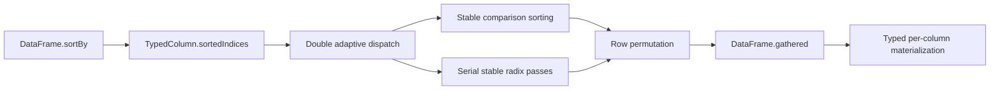

# Existing stable Double sort path

Inspected local commit `2196173097b55cb6b15a8d619e6d8032d0e95106`. This is source inspection, not a new build or timing result.

## Overview

`DataFrame.sortBy` first asks the named column for a row permutation, then copies every column into that order. Double permutation generation is currently serial. The later gather can run columns concurrently. These are separate costs and separate scheduling decisions.

## Dispatch and ordering

`DataFrame.swift:564` throws `columnNotFound` for an absent key. Otherwise it calls `sortedIndices`, then `gathered`. The public call returns a complete new dataframe, not an index view.

`TypedColumn.swift:315` dispatches Double to `sortIndicesDouble`. Float, Int64, Int32 and Int use the generic cached-value comparison path. Strings, Dates and Bools use optional-key comparison sorting. Bool maps to 0 or 1. Custom supported types use numeric promotion when available, then string comparison. A Double experiment should leave these other dispatches unchanged.

For Double, `sortIndicesDouble` at line 427 uses comparison sorting when there are fewer than 1,024 non-null values, or when `validCount < values.count / 20`, with integer division. Otherwise it scans the non-null values and counts direction changes between unequal neighbors. The run limit is `max(8, validCount / 64)`. Inputs that stay below that limit use stable sorting of cached `(row index, value)` pairs. Exceeding the limit releases those temporary pair and missing-row arrays and tries radix sorting over the complete original input.

Equal numeric values retain source row order in both directions. Nulls append after all non-null values, preserving source order, in both directions. Positive and negative zero compare equal. Radix key construction normalizes their sorting key to the same value, but gather copies the original Double payload, so signed-zero bits survive. Infinities, subnormals and finite values use their ordinary numeric order. Descending radix sorting complements the transformed key before sorting; it does not reverse an ascending result, which would reverse ties.

NaN deliberately retains the existing optional comparison-sort behavior. Either adaptive scanning encounters it, or the complete radix preparation scan rejects it and the caller falls back. The fallback comparator uses ordinary `<` or `>` and explicit nil branches. It does not establish a NaN placement or an IEEE total order. Because NaN violates the comparator's strict-order assumptions, this path must be preserved as compatibility behavior rather than described as a general sorted-order guarantee. Existing tests compare its exact output with the same Swift comparator. A new parallel implementation must fall back before partially publishing a permutation, including when NaN occurs beyond the initial adaptive scan.

## Radix data and ownership

`radixIndicesDouble` at line 476 builds one UInt64 key slot for each source row, original-row indices for each non-null row, and a separate missing-row list. The monotonic bit transform flips the sign bit for nonnegative values and complements negative values. The original payload array remains unchanged.

Radix scratch consists of a second non-null index buffer and 2,048 Int histogram/offset slots. On this arm64 target the histogram is 16 KiB. Six potential 11-bit least-significant-digit passes cover the 64-bit key. The last pass has only nine meaningful bits. A differing-bit mask skips constant digits. Every pass scans source indices in order and advances each bucket offset, so scatter is stable. Source and destination pointers swap after each pass. The final array owners swap if necessary, then missing rows append. The implementation borrows all buffers for the entire pass sequence, avoiding repeated Swift array mutation checks inside the loops.

For N total rows, V valid rows and M missing rows, element payload capacities are approximately `8N` key bytes, `8N` reserved original-index bytes, `8V` scratch bytes, `8M` missing-index bytes and 16 KiB offsets. This excludes Swift allocation headers, the input column, adaptive inspection allocations, and the final gathered columns. The original-index array reserves N even though its initial count is V. Existing adaptive inspection reserves V cached pairs before deciding to switch to radix; those owners are released before the radix call. Logical payload size is not peak RSS.

There is no concurrent work in either current permutation generator. All mutation belongs to the calling task. A parallel trial must prove disjoint output regions, private or partitioned histogram state, stable worker ordering within each bucket, and completion before buffer borrows end. Sharing mutable Swift Arrays across closures without that ownership proof would change this safety model.

## Gather and language boundary

`DataFrame.gathered` at line 666 estimates bytes per output row from each column's Optional element stride. With at least two columns and enough selected rows to reach approximately 512 KiB, it calls `DispatchQueue.concurrentPerform` once per column. Otherwise it maps columns serially. Each concurrent iteration owns one destination column slot. Source columns and the permutation are shared for reads; the synchronous call completes before the destination borrow ends. The existing code passes the destination address through an Int and reconstructs its pointer in each closure. That is an existing manual disjoint-write proof, not compiler-enforced ownership.

`TypedColumn.gathered` uses the concrete Double gather, concrete numeric gathers, and the new String, Bool and Date scalar specializations. Custom types keep the generic scalar fallback. Each gather allocates a new Optional array, copies selected elements, caches the resulting null count, and retains names and types. No row-partition gather is active. `vGather` is a scalar indexed loop despite its name; this path does not call a vDSP gather routine.

`Package.swift` declares Swift tools 6.0, `ExistentialAny`, and macOS 14 minimum. `AnyColumn` is Sendable and `SupportedType` requires Sendable and Hashable. The existing comparison helper keeps direction within one closure because source comments record a Swift 6.4 Release miscompilation with separate generic ascending and descending closures. The next trial must keep macOS 14 compatibility and cannot assume newer concurrency or uninitialized-array APIs are available. No new Swift or OS requirement follows from parallelizing these algorithms alone.

## Existing checks worth retaining

- `AdaptiveDoubleSortingTests.swift` checks dispatch-size boundaries, stable duplicate rows, sparsity, monotone and nearly ordered inputs, nils, signed zeros, infinities and floating-point extremes. It compares copied Double bit patterns and checks source preservation.
- `RadixBufferSortingTests.swift` varies the active digit count and both directions, checking exact stable permutations and unchanged source bits.
- `NumericSortTests.swift` checks numeric types, exact integer extremes, both directions, nulls and existing NaN fallback behavior.
- `DescendingNullSortTests.swift` protects the previous Release descending/null regression and public dataframe callers.
- `ScalarGatherSpecializationTests.swift` checks the specialized scalar copies and a custom SupportedType fallback.

The parallel-sort comparison should report permutation generation separately from full `sortBy`, because materializing wide or mixed columns can dominate even after permutation generation improves.
