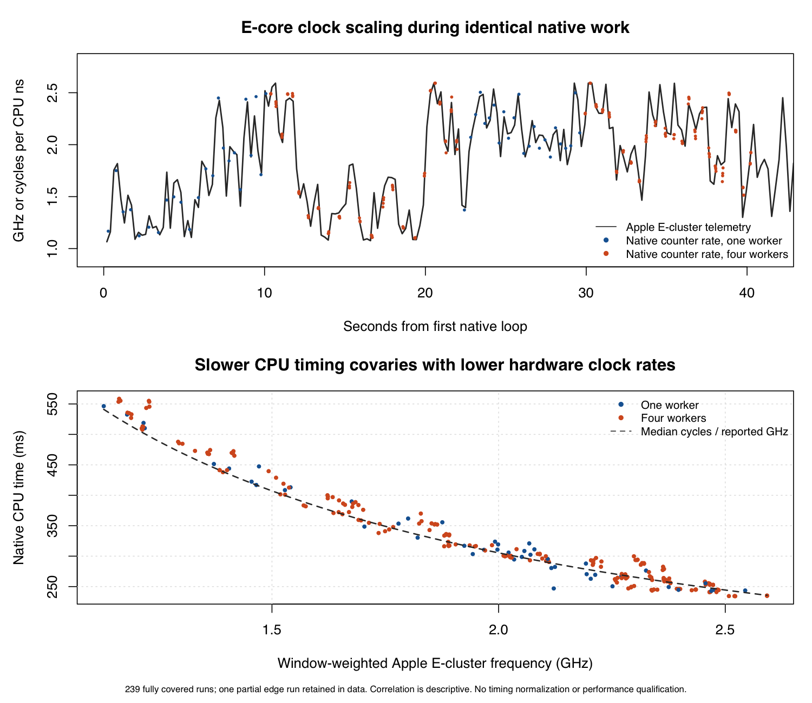

# E-core clock scaling and benchmark repeatability

The authenticated capture identifies changing E-core clock rates as a major contributor to the native CPU-time variation. The same fixed register loop ran with zero P-core user time throughout, while Apple's reported E-cluster frequency changed from 1.065 to 2.592 GHz. The relationship between the independently reported hardware frequency and the native counter rate is strong after clock alignment.

This explains why enforcing the same processor type did not make CPU milliseconds repeatable. The earlier observation fault and this execution-rate variation are separate. The observer-isolation profile passed its coverage checks; the older performance comparison remains unqualified.

[Download the figure as a PDF](frequency-correlation.pdf).

## Captured evidence

The user ran the reviewed script with local administrator authentication. The profiler produced 600 valid property-list reports, and the native program produced 240 matching checksums with zero P-core user time. All ten recorded native probe processes have exited.

The requested 200 ms sampling period produced a median interval of 222.167 ms. The complete telemetry spans 133.829 seconds. The native workload occupied about 40.6 seconds within that capture. This is diagnostic instrumentation, not an uninstrumented production performance result.

| Observation | Result |
| --- | --- |
| Native CPU time range | 234.220 to 558.506 ms |
| Apple E-cluster frequency range | 1.065 to 2.592 GHz |
| Fully covered native intervals | 239 |
| Partial native intervals, retained in raw data | 1, at the initial capture edge |
| Primary frequency/counter-rate correlation | 0.9838 |
| Correlation at four selected clock offsets | 0.9403 to 0.9838 |
| Thermal-pressure reports | Nominal in all 600 samples |
| Nonzero forced-idle endpoints | 0 of 600 |

The fastest and slowest CPU-time quartiles each contain 59 fully covered runs. These groups describe the same fixed native operation, not different implementations.

| Group | Median CPU time | Median hardware frequency | Median native cycles per CPU ns |
| --- | ---: | ---: | ---: |
| Fastest quartile | 246.027 ms | 2.435 GHz | 2.473 |
| Slowest quartile | 468.065 ms | 1.384 GHz | 1.309 |

Native instruction and cycle counts remain close between the groups. The hardware-frequency averages cover shared-cluster sampling windows, so they do not identify the exact instantaneous frequency of each worker. The plot's dashed curve is the diagnostic relationship between median counted cycles and frequency. It does not normalize any benchmark result.

## Clock alignment

The captured system Python 3.9 monotonic anchors have a process-relative origin, while the C probe uses absolute Mach timestamps. Subtracting them directly would be wrong. Python documents that macOS monotonic clocks became common across processes in Python 3.10. The production comparison controller uses recorded Python 3.14.6; this older-runtime diagnostic issue does not invalidate its queue anchors. [Python time documentation](https://docs.python.org/3/library/time.html#time.monotonic)

The analysis maps native Mach timestamps to wall time through a separately recorded direct clock bridge. The original bridge-producing command was not saved as a file. The archive preserves its 100 raw paired samples and a reconstructed producer labeled as such; that reconstruction does not prove the original command identity. That bridge lies inside the conservative 143.231 ms offset envelope derived from the captured workload's wall-clock start and end. The analysis evaluates the live bridge, both envelope bounds, and the envelope midpoint. These four selected offsets give correlations from 0.9403 to 0.9838. This is not a continuous test of every possible alignment, and the telemetry origin remains at its midpoint. The analysis does not choose the offset that maximizes correlation.

The telemetry stores whole-second dates alongside nanosecond elapsed intervals. Intersecting their constraints yields a 1.211 ms interval for the sampling origin under an end-of-interval interpretation. A start-of-interval interpretation has no common origin under the same model and remains recorded as a rejected interpretation. The rejected start model misses consistency by 2.441 ms. This model comparison does not prove the exact point at which powermetrics records its timestamp. Current CoreFoundation serialization tests confirm that XML date encoding discards fractional seconds; Apple's published writer does the same. [Apple's published property-list writer](https://github.com/apple-oss-distributions/CF/blob/main/CFPropertyList.c)

The first native interval begins before the first reconstructed telemetry window. Its result remains in the raw data and plotted timeline, but it is excluded from the fully covered correlation and quartile summaries. The excluded count and coverage fraction are explicit in `matched-native.json`.

## What this establishes

The capture directly observes frequency changes during the fixed native workload. Lower reported hardware frequency aligns with higher CPU time. Together with matching computation results, stable work counts, and the earlier reproduction without hardware telemetry, this supports clock scaling as a real cause of timing variation independent of the dataframe implementation.

The capture does not identify the exact operating-system rule selecting each clock rate. Nominal thermal pressure is not a temperature measurement and does not exclude every thermal influence. The installed Apple manual says the SFI values are instantaneous at sample endpoints, so zero endpoints do not exclude brief forced-idle events. Wall time also includes waiting that CPU time excludes. The data does not classify every waiting interval.

The 239 intervals are not statistically independent, because concurrent workers share a frequency domain. Correlation is descriptive; no p-value or independent-sample confidence interval is claimed. The trace also cannot attribute system-wide power estimates to the native probe or compare energy efficiency among libraries.

## Consequences for the benchmark

Matching E-core execution is necessary for the requested comparison, but it does not fix the hardware operating rate. CPU milliseconds remain useful, while instruction counts, cycles, memory, and operating-state evidence answer different questions.

The next comparison protocol needs to record those operating states and define its repeatability rules before collecting timings. It must retain the native library pools, equivalent schemas and outputs, balanced order, resource accounting, and failed controls. Adding artificial competing work or scaling old timings to a chosen frequency would change the question instead of validating the existing comparison.

No production code, old measurement, tolerance, or failure inventory changed in this analysis. The eight CPU or elapsed-time failures from the observer-isolation smoke remain failures. This native trace does not retroactively prove which hardware state occurred in each earlier CSV queue, and it establishes no library ranking or energy claim.

See [analysis output](correlation.json), [clock bridge](live-clock-bridge.json), [capture provenance](capture-provenance.json), [replay instructions](REPLAY.md), [saved review](review.md), and [review disposition](review-disposition.md) for the evidence limits.

## Verification and preservation

The replay test runs the correlator on the archived raw capture in a fresh output directory, checks the selected bridge, checks all four sensitivity cases and the partial edge, and compares all four numeric outputs byte for byte with the saved analysis. The three focused overlap and timestamp tests remain separate. An integrity manifest binds the archived inputs, scripts, receipts, and results. No workload is rerun during replay.
