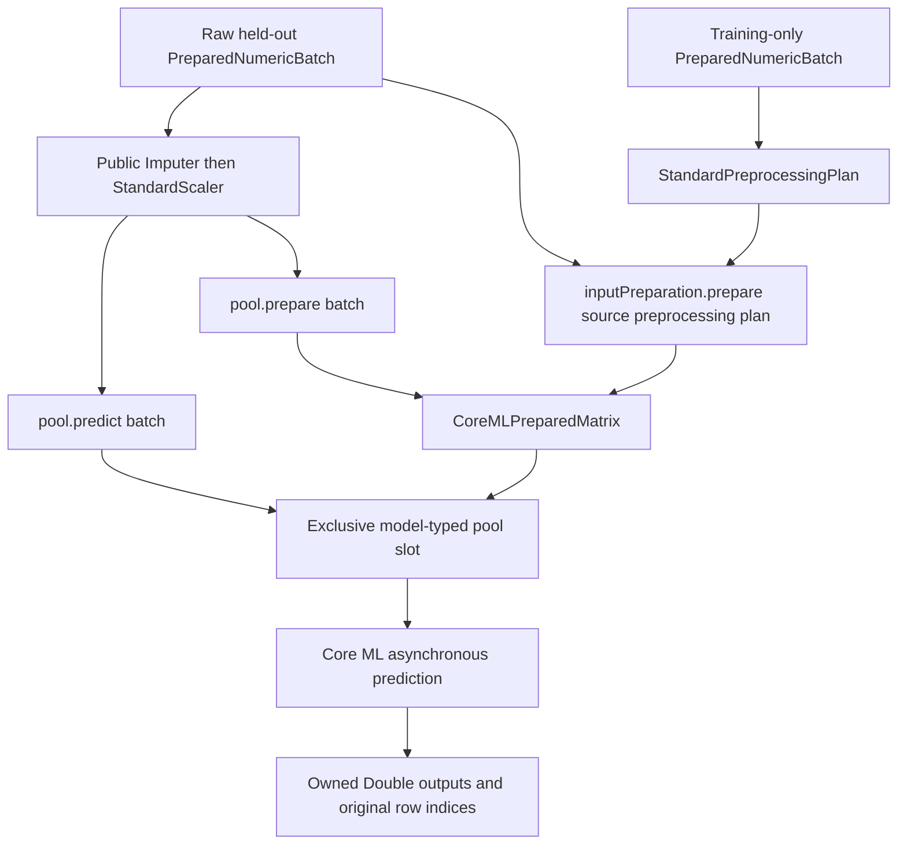

# Representative ML Program qualification

## Overview

SwiftSci already supports fixed-shape Float16 ML Programs through its public matrix pool and fitted preprocessing APIs. The missing work is qualification of representative trained weighted models, complete numeric output assessment, and observed device events. A new inference API, runtime, scheduler, or memory manager is unnecessary.

Use the frozen WDBC and wine models from the completed representative study. Begin with WDBC's full 126-row held-out fixture, then wine's 342 rows. These shapes already meet the generic native concurrency worker's bounds. The existing Python orchestration commands and fused benchmark impose Covertype-specific assumptions, so a small task-local controller and public-API assessment probe are less invasive than changing those commands for this study.

## Ownership and data flow

`PreparedNumericBatch` owns Double columns, feature names, validity information and row provenance. `StandardPreprocessingPlan(training:)` fits imputation followed by scaling once on training observations. Its immutable statistics belong to the fitted plan. Inference must not refit them on held-out observations.

The caller compiles the source `.mlpackage` and opens `CoreMLMatrixPool.withPool`. The pool admits its lifetime quota before loading the model, validates a fixed rank-two floating input/output pair, and owns one exclusive input/output buffer pair per admitted prediction slot. The caller owns source batches and any retained prepared matrix outside the request reservation. Returned predictions own Double output columns and preserve the input's original row indices.

There are three existing public input paths:

Direct prediction converts Double inputs to the declared model element type on each request. `pool.prepare` performs conversion once into immutable model-typed storage. Public fused preparation uses bounded Double tile workspace, applies training-fitted imputation/scaling, then converts once into that same owned storage. Both prepared paths still copy bytes into an exclusive prediction slot. They do not promise zero-copy native execution.

`CoreMLMatrixInputPreparation` retains shape/type metadata rather than the model or pool. It can prepare input after the original pool closes. A prepared owner can feed another pool with compatible dimensions, type and ordered feature names. The owner releases its memory reservation asynchronously after its final reference disappears, so qualification must await budget drain.

## Existing evidence and its limits

The existing `[3,2]` Float16 ReLU fixtures are ML Programs. They cover typed packing, finite-value rejection, row mapping, pool concurrency and ownership. Existing fused tests also compare staged and fused preparation for Float16. The larger `[83,64]` tile test uses Float32 legacy ReLU. These tests separately cover mechanisms that a trained Float16 model combines, but they do not establish representative numeric accuracy or device placement.

`prepare_models.py` can convert the frozen dense/ReLU weights into matched legacy, `program32` and `program16` artifacts once its binary fixture descriptors exist. Both programs use Float16 compute. `program32` means Float32 input/output transport, and must not be labeled a full-precision internal control. The converter starts from frozen Float32-rounded weights; its program16 builder explicitly casts constants to Float16, while the program32 conversion supplies Float32 constants before the Float16 compute conversion. Record artifact identity and resulting numeric errors rather than assuming identical internal arithmetic.

The generic `--coreml-concurrency` worker accepts the representative shapes unchanged. It checks normal/reversed inputs, recovered bad-input requests, stable output hashes, retained output stability, row identity, concurrency and final budget drain. Its records retain strict preflight mismatch counts, not complete outputs. That is sufficient for repeatability and ownership checks, but insufficient for application scoring or detailed numeric error distributions.

The existing prepared workflow additionally records maximum reference error, but its request validator limits rows to 1024/8192. The existing fused benchmark also fixes Covertype training counts and held-out IDs. Neither restriction implies a limitation in the public library.

## Keep the judgments separate

| Judgment | Evidence required | What does not establish it |
|---|---|---|
| Adapter and ownership correctness | Same-artifact/policy output equality across direct, retained and fused paths; exact provenance; compatible-pool reuse; request completion; final owner/quota drain | Agreement with a low-precision reference alone |
| Strict reference accuracy | Complete output vector against frozen independent Double formula, `abs(actual-expected) <= 1e-5 + 1e-5*abs(expected)`; exceedance count and error summaries | Exact equality among paths that share one quantized model |
| Application quality | WDBC logit-to-sigmoid scoring and classification metrics; wine inverse target scaling and RMSE; comparison with frozen model and constant baseline | Successful Core ML execution or preserved labels alone |
| Actual device execution | Target-process Instruments events inside the measured signpost, with discovered ML Program event schema and observed device dispatch | `.cpuAndNeuralEngine`, a compute plan, or output backing adoption |

There is no established new application-quality acceptance threshold. Preserve that fact. The prior WDBC accuracy is 0.9603 against constant 0.6032. Wine RMSE 0.9569 is worse than the constant baseline 0.8095. Keep the frozen weak wine model to distinguish inference fidelity from model utility. Do not retrain it using observed held-out outcomes.

## Smallest additions and execution sequence

1. Verify the original frozen fixture, raw-source and training-metadata digests. Derive row-major little-endian f64 binaries and descriptors from the inline fixture without changing weights, splits or expected outputs. Record original-to-derived digests. Run existing `prepare_models.py` on those descriptors. Preserve every `.mlpackage` file, including external weights, and measure conversion separately if reporting deployment costs.
2. Write a task-local controller that imports existing `concurrency.run_case`, `validate`, and `program_pool.validate_backing_counts`. Bind source/build/binary/Metal/controller/fixture/model fingerprints. Start with WDBC program16 and program32, CPU-only, one caller/slot, direct versus persistent. Expand to neural-permitted policy and four callers after the bounded first cases complete. Then repeat wine.
3. Adapt the prior task-local `RepresentativeWorkflowProbe.swift`. Replace its legacy exporter/predictor construction with loading the supplied package and using the public matrix pool. Retain its raw-data split, train-only scaler check and full output-vector capture. Add public `Imputer` plus `StandardScaler` as the staged control and `StandardPreprocessingPlan` plus `inputPreparation().prepare` as the fused path. Compare direct, retained and fused outputs exactly within the same artifact and policy, and score each complete vector independently against frozen references and task targets.
4. Use full held-out shapes for the main assessment. They exercise multiple preprocessing tiles and partial final tiles at widths30/11. Add a deterministic duplicate/reversed row selection to verify provenance and row-specific output mapping. A controlled missing-value case, if included, must have a separately derived training-imputation reference and must not replace the frozen held-out task scores. Existing synthetic tests already cover cancellation/admission mechanics; duplicate those only if a representative run exposes a failure.
5. Keep model compilation/loading, source construction, plan fitting, preparation, prediction bursts, output validation and final reservation drain as separately named timing scopes. Measure preparation-plus-burst when comparing reuse. Cooperative budget allowances and sampled RSS answer different questions. Output backing adoption is optional and records object identity rather than absence of internal copying.
6. Capture bounded Instruments traces from representative program requests using the existing signposts and task-local adaptations of `trace-trained.py`/`inspect-traces.py`. Discover actual tables and events. Remove the old legacy study's exact CPU-dispatch assertion from the adapted assessment rather than treating it as an ML Program expectation. Keep `executionTraceVerified` separate from worker success.
7. Publish the artifact-bound assessment, numeric/task results, timing scopes and actual device findings. Choose subsequent production changes only from reproduced defects or a concrete consumer requirement.

The only initial additions are qualification files outside production source. If a durable reusable benchmark is warranted after the study, its first change should replace explicit Covertype fixture assumptions with a checksum-bound fixture contract. The production composition already exists.

## Where to look

- `Sources/SwiftML/Serialization/CoreMLMatrixPool.swift`, `CoreMLPreparedMatrix.swift`, and `CoreMLMatrixInputPreparation.swift` own public pool, prepared storage and fitted preparation behavior.
- `Sources/SwiftPreprocessing/Core/StandardPreprocessingPlan.swift` and `StandardPreprocessingRowWriter.swift` own training statistics and tiled typed conversion.
- `Benchmarks/Worker/CoreMLConcurrency.swift` and `CoreMLPersistentConcurrency.swift` provide shape-generic native stress execution.
- `Benchmarks/Worker/CoreMLProgramArtifact.swift` hashes complete source packages and probes compiled schema. Its CPU schema load occurs before measurement, so later load timing is not cache-cold evidence.
- `Benchmarks/CoreMLInference/prepare_models.py`, `concurrency.py`, and `program_pool.py` provide reusable conversion, execution and validation functions.
- `/private/tmp/swiftsci-coreml-representative-20261026/RepresentativeWorkflowProbe.swift` is the smallest starting point for full outputs and raw preprocessing assessment.

This synthesis checks the two grounding reports against the public fitted-plan/preparation code, package hashing/probing, conversion code, existing fused fixture guards, and prior representative workflow probe. No execution or passing qualification result is asserted here.
