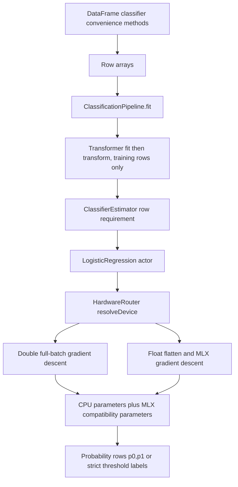

# Prepared classification grounding

Read-only source trace, 2026-10-26. Source root is `/private/tmp/swiftsci-prepared-classification-20261026/source`, observed HEAD `e19db7dda4567c425b7eb002da82e234e6c7980f`. This is the pre-PCA base; this checkout does not contain PR89's prepared PCA implementation or its matrix replacement helper. No source changes, builds, or CI runs were performed.

## Overview

Classification still enters through nested row arrays. `ClassifierEstimator` requires row-array fit, labels, and probability methods. `ClassificationPipeline` preprocesses those rows, then calls the estimator through that protocol. Logistic regression contains separate Double CPU and Float MLX training implementations. Its CPU fit allocates sample predictions and weight-gradient arrays afresh in every epoch. Prepared regression already demonstrates the intended integration point: add prepared requirements to the public estimator protocol, offer compatibility defaults for existing conformers, and let the native estimator and pipeline override those requirements.

A prepared classification change can reuse existing numeric snapshots, supervised selection, preprocessing dispatch, GPU packing, and admission-control types. It need not add a second dataframe or generic training framework. Repeated full fits are currently independent training runs starting from zeros; there is no partial-fit or warm-start contract.

## Call and data flow

`Sources/SwiftML/Core/DataFrame+ML.swift:4` extracts `toFeatureMatrix` and `toTargetVector` independently, then calls protocol row methods. It does not select features and targets together or retain a named training schema. Existing calls should remain available.

`Sources/SwiftML/Core/EstimatorProtocols.swift:103` declares three classifier requirements, all accepting `[[Double]]`. Its extension supplies an unsupported probability default, `predict(instance:)`, and `predictProba(features:)`, which wraps probability rows in `ProbabilityMatrix`. Native prepared overloads added only in an extension would not dispatch to conformer implementations through `any ClassifierEstimator`; protocol requirements are necessary, as the existing regressor API demonstrates at line 170 onward.

`Sources/SwiftML/Core/EstimatorPipeline.swift:26` fits every transformer and transforms the training input in sequence, storing the mutated existential transformer back through indexed array access. It then awaits its classifier. Prediction runs transform only, then label/probability prediction. Classification has no named schema, failed-refit flag, output row validation, consuming prepared method, or budget wrappers. This class is `@unchecked Sendable`, with public mutable transformer configuration. Actor isolation inside LogisticRegression does not make pipeline transformer mutation safe. The regression documentation's rule to configure before fitting and serialize fitting/configuration remains the appropriate precedent.

`Sources/SwiftML/Core/LogisticRegression.swift:54` supplies default controls `learningRate: 0.1` as Float and `epochs: 1000`. The configurable fit only rejects empty features or targets. It awaits `HardwareRouter` with row count and first-row width, assigns `resolvedDevice` before solver execution, then chooses CPU or GPU. `Sources/SwiftPreprocessing/Core/HardwareRouter.swift:39` chooses CPU for fewer than 1,000 logistic rows under `.auto`, GPU otherwise. Explicit `.ane` maps to GPU; explicit CPU/GPU are preserved. Feature count is not the logistic routing threshold.

CPU fit at LogisticRegression line 100 starts weights and bias at zero. Every epoch computes each row's dot product in ascending feature order, then sigmoid. A second ascending-row loop accumulates gradient bias and each feature gradient. It divides sums by sample count, checks gradient finiteness, and updates parameters. This is full-batch mean unregularized binary cross-entropy gradient descent. Arithmetic order should remain unchanged if exact row/prepared agreement is required. `predictions` and `gradW` are allocated inside the epoch loop; allocating them once and clearing gradient storage each epoch removes repeated allocations without changing the algorithm. It stores final Double arrays and Float MLX compatibility parameters after the loop. The last parameter update itself is not checked for finiteness.

GPU fit at line 158 receives one flat Float feature array reshaped N by P and Float targets. `valueAndGrad` differentiates `Losses.binaryCrossEntropy` through MLX matrix multiplication. The epoch loop builds updates; evaluation and finite-parameter checks occur after all epochs. Public MLX weights and bias are then mirrored to Double arrays. There are no cancellation checks in either logistic training loop. The only await in fitting is device resolution. The actor can reenter during that await, so concurrent fits can reorder routing responses; afterward each synchronous solver blocks actor access until it succeeds or throws. Parameter assignments have no suspension between them, so actor observers do not see intermediate assignment states. The failure hazard is old parameters paired with the already changed resolvedDevice. CPU Double and GPU Float algorithms are distinct numerical routes; prepared input must not silently change routing or precision.

`binaryPositiveClassProbability` at line 214 returns empty output for empty rows before fitted-state checks. On a resolved CPU model it uses retained Double parameters directly. Other routes flatten input to Float MLX and call `predictProbability(X:)`, which validates fitted state, nonempty size, rank and width. The CPU row route has no width validation and indexes using weight count. A short row can trap and extra columns are ignored. `predictProbability(features:)` returns `[1-p, p]`; labels compare `p > Double(threshold)`, not greater-or-equal. `predict(features:)` uses Float threshold 0.5. MLX labels use the same strict comparison.

Supplied-parameter construction at line 32 sets CPU parameters and MLX mirrors, resolves `.auto` and `.cpu` directly to CPU and the remaining choices to GPU. Loading saved models uses this initializer. `ModelPersistence.swift:135` saves only weights and bias, not feature names. `CoreMLExportable.swift:275` reads parameter getters. `OneVsRestClassifier.swift:43` trains fresh logistic actors concurrently on binary targets and consumes positive probabilities. Preserve getter signatures and these downstream behaviors.

## Prepared ownership and alignment

`Sources/SwiftDataFrame/Core/PreparedNumericBatch.swift` owns compact Double columns, validity bits, names, row count, and optional source-row mapping. The public dense initializer checks shape but permits duplicate names, valid NaNs and infinities. `selectingRows` validates indices before gathering, preserves supplied order and duplicates, and composes original row identity. Array copy-on-write preserves previously selected snapshots when the source is mutated.

`PreparedSupervisedBatch` at line 282 stores one batch plus a target index. It requires unique names and at least one feature plus one target. `selectingRows` gathers target and features together. `features` returns the same column storage excluding the target, preserving provenance; `targets` returns the matching value buffer. Missing targets emerge as NaN. This is the existing safe training-split entry point, usable for classification without a new wrapper.

`requireFinite` at line 267 rejects missing or nonfinite feature values, but its error text currently says regression. Reusing it for classification exposes misleading wording. `rowValues` explicitly materializes rows and must be confined to compatibility defaults, not the native path.

`PreparedNumericMatrix` at line 227 owns contiguous Double values, names, row count, layout and provenance. Public subscript handles row-major or column-major layout. Construction is through `batch.matrix` or `DataFrame.prepareNumericMatrix` in `DataFrame+Matrix.swift:71`; direct extraction can select repeated rows and duplicate named columns. Missing-policy reject rejects nil but still permits valid NaN, so a model must validate finiteness itself. There is no prepared matrix estimator precedent in LinearRegression; that estimator's prepared native support currently accepts batches only.

`Sources/SwiftPreprocessing/Core/PreprocessingTransformer.swift` already declares prepared fit/transform and consuming-transform requirements. Compatibility defaults convert once to rows; default transform rejects changed final shape and restores original names and provenance. Native prepared composition is opt-in through `supportsNativePreparedBatches`. StandardScaler, MinMaxScaler and Imputer opt in. Prepared classification can follow this contract directly.

`Sources/SwiftPreprocessing/Core/ScopedGPURead.swift` packs a batch into row-major Float storage, imports aligned eligible extents or copies others, and synchronizes the GPU stream before releasing the input owner even on errors. Native logistic GPU prepared support can reuse it instead of building nested row arrays or inventing storage lifetime rules. Evaluate outputs within its synchronous operation; lazy results must not escape. A finite Double can overflow when converted to Float, a documented existing regression limitation.

## Regression precedent and state implications

`EstimatorProtocols.swift:195` provides prepared regression compatibility defaults with finite input and target-alignment checks, supervised fit convenience, and caller-estimated `MemoryBudget` wrappers. Its defaults retain legacy conformers but do not remember feature names. Budget reservations release on completion/error; returned state and outputs may outlive reservations.

`RegressionPipeline` at `EstimatorPipeline.swift:67` adds remembered input names and `needsSuccessfulFit`. It validates prepared input before changing transformers. Once a refit can mutate transformers, any error leaves predictions unavailable until another fit succeeds. On successful row-array fit it clears named schema; on successful prepared fit it records the original input names. It checks output row count and transfers prepared intermediates through consuming transforms. This is a strong concrete classification precedent.

`LinearRegression.swift:7` uses private row/column accessors and a shared generic numerical implementation. Its CPU arithmetic order stays the same for both representations. Prepared names commit only after successful fitting. However `resolvedDevice` changes before its solver succeeds. Copying that detail into logistic would preserve a mixed-state hazard: old parameters with new routing after failure. A logistic refactor should compute the routed result locally and publish parameters, names, and resolved device together after success. Validation errors should preserve the old model; pipeline failures after transformer mutation require invalidation. A cancellation check before final publication is needed if training becomes cooperative.

## Frozen numerical workload and test gaps

`Benchmarks/Worker/SupervisedWorkloads.swift` decodes strict fixture schemas, unique names/row ids, disjoint exhaustive nonempty train/validation/test indices, finite values, and binary labels with both classes in every split. Scaling fits only training rows. Gathering, scaling, model construction, training, all predictions, metrics and output serialization are inside the full workflow scope. Decoding is outside.

`Benchmarks/Worker/SwiftClassifierWorkloads.swift` calls the configurable CPU logistic fit and gathers parameters, `[p0,p1]` rows and strict-threshold labels. Its output also includes training prevalence and model/baseline metrics. The frozen contract is `Benchmarks/Specs/workloads/supervised-logistic-cpu-v1.json`, with `atol=1e-8`, `rtol=1e-9`. `Benchmarks/Python/classification_workloads.py` supplies an independent NumPy/SciPy implementation. Fixtures under `Benchmarks/Fixtures/supervised/inputs/wdbc-supervised-logistic-cpu-epochs{0,1,32}.json` cover finite-step behavior.

Zero epochs is intentional and already exercised. It must produce zero weights/bias, probabilities 0.5 and labels 0. LinearRegression's positive-epochs validation cannot be copied unchanged. Nonnegative epochs preserve this contract. The public Float learning rate also matters: fixtures demand an exactly Float32-representable rate. No convergence, tuned quality, or speed claim follows from this workload.

Current logistic tests cover separable fitting, supplied parameters across device requests, empty fit, and unfitted prediction. `Regression+RoutingTests.swift:54` loosely compares CPU/GPU logistic probabilities. `EstimatorPipelineTests.swift:8` tests a classification pipeline using DecisionTreeClassifier, not LogisticRegression. Prepared classification, no-row dispatch, named schema, invalid shapes, invalid targets/control values, canceled refits, allocation reuse, and strict threshold ties lack dedicated coverage.

`Tests/SwiftMLTests/PreparedRegressionIntegrationTests.swift` is the best integration test pattern. It proves native protocol dispatch by making legacy methods throw, verifies selected repeated rows and snapshot independence, preserves legacy-only conformers, compares exact CPU parameters/predictions, rejects reordered schemas through erased protocols, tests failed-refit behavior, and checks admission release. Classification should include probability dispatch and output shape as well as labels, and verify existing unsupported-probability behavior for classifiers that do not implement probabilities.

## Scope choices to settle before implementation

1. Add prepared batch requirements and compatibility defaults to ClassifierEstimator, then native ClassificationPipeline and LogisticRegression support. Decide whether direct matrix overloads are required now or follow later; regression provides no matrix protocol requirement to mirror.
2. Keep learning rate and epochs available for prepared native logistic fits. Protocol defaults can retain the existing fixed default controls. Do not introduce warm-start, online training, or partial-fit semantics under the phrase iterative training.
3. Reuse per-fit CPU scratch arrays across epochs, keeping row-then-column summation and zero initialization. Do not swap in BLAS reductions without new numerical evidence.
4. State binary-label validation separately for LogisticRegression. ClassifierEstimator supports multiclass conformers and should only enforce generic finite/aligned targets.
5. Preserve the zero-epoch contract, threshold strictness, Float controls, device resolution policy, and supplied-parameter behavior. Validate before routing and publish successful model state together.
6. Keep pipeline fitting/configuration serialized, use the established failed-refit invalidation rule, and account for retained input/output separately from caller-estimated admission reservations.

No source implementation or CI was started as part of this grounding task.
