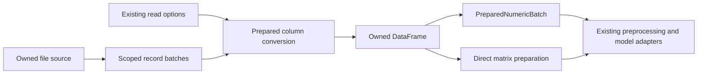

# CSV ingestion and numerical handoff strategy

Proposal, 2026-10-21. Source baseline `a5f6e78a751365ec360efdd4ae8f028db04b441b`. No implementation, dependency change, new performance result, or upstream submission accompanies this strategy. Keep this decision record on `codex/engineering-notes`.

Implementation progress and measurements are recorded in the [prepared-date report](../benchmarks/2026-10-21-csv-prepared-dates/README.md). The proposal below remains the architectural reference. The [scoped streaming report](../benchmarks/2026-10-21-csv-scoped-streaming/README.md) records the scalar tradeoff, the SIMD follow-on, and the remaining eager-inference gate.

## Decision and purpose

Make ingestion a resource-efficient part of the scientific workflow. Prepare conversion rules once, convert source bytes with as little intermediate work as the contract permits, release temporary metadata promptly, and preserve compact data when the next consumer supports it. Keep the existing dataframe interface during ingestion repairs. Evaluate a broader column-storage change together with its consumers under issue #40.

The recommended destination is a shared conversion implementation over scoped record batches. The first deliverable is a characterized behavior contract and reproducible workflow baseline, followed by prepared date conversion within the existing reader. Replacing the full-file index is a later measured decision, not a prerequisite for improving date conversion.

This follows the [resource-efficiency charter](../CHARTER.md#resource-efficiency-across-the-library). Correctness, safe ownership and maintainability are gates. CPU work and memory are separate resource measures; latency is a workload constraint. A lower elapsed time with more CPU or memory is a tradeoff. No universal weighted score or promised speedup is proposed.

## Evidence and present architecture

The [source comparison](2026-10-21-csv-date-source-comparison.md) traces the exact pandas, Polars and DuckDB versions used in the [matched reference benchmark](../benchmarks/2026-10-21-csv-matched-reference/README.md). It supports three independent investigations:

- SwiftSci reuses one formatter but still performs String construction and Foundation date conversion per non-null field. DuckDB's traced path directly parses bytes into timestamp storage without a converted-date cache. Polars has both a supported byte parser and bounded reuse. Cheap distinct-value parsing matters independently of repetition.
- The large unquoted SwiftSci path creates a complete field index. For the energy file its logical field and row metadata is about 301 MiB. This is temporary payload, not an attribution of all observed RSS.
- CSV output remains `TypedColumn<T>` with public `[T?]` values. On the measured toolchain `Double?` and `Date?` have 16-byte strides. Existing compact numerical batches are downstream representations; CSV does not populate them directly.

The source trace at the baseline establishes the following. These are code observations, not newly reproduced failures or memory measurements.

| Owner | Current behavior and consequence |
| --- | --- |
| `CSVReader.read`, `Core/DataFrame.swift:61` | Map file, index it, then convert columns concurrently. Output arrays own their values independently of the input. `maxRows` limits conversion after indexing. |
| `CSVReader.readStream`, `IO/CSVReader.swift:487` | Maps and indexes the full file, constructs frames per row chunk, and yields into an unbounded producer stream. Inference is per chunk. Streaming `maxRows` is not applied in the visible loop. |
| `ChunkedDataFrame`, `Core/ChunkedDataFrame.swift` | `filter`, `select`, `mapChunk`, and `join` also create producer tasks with unbounded stream buffers. Reader-only backpressure would not bound these compositions. |
| `SystemsCSVParser`, `CSVRecordIndex` | Own quote/framing logic and scoped offsets. The unquoted parallel path has full-width offsets; the general path can use compact offsets. Existing SIMD structural scans are reusable. |
| `CSVReader.inferColumn`, `JSONReader.swift:49` | JSON uses the String-based inference helper. It is a real consumer, even though the internal whole-String CSV parser has no production caller in the source search. |
| `PreparedNumericBatch`, `DataFrame+Matrix.swift:44` | Owned Double columns with separate validity, selection/provenance and copy-on-write. Preparation from a dataframe currently converts optional arrays. Dates are unsupported, and Int64-to-Double follows existing precision limits. |
| `DataFrame.prepareNumericMatrix`, `DataFrame+Matrix.swift:68` | Direct owned matrix preparation already avoids an intermediate compact batch. Do not route this caller through an extra representation. |
| `ArrowTableBridge` | Copies into optional columns on import and builds Arrow output on export. Existing Arrow integration does not make CSV zero-copy. |
| `SwiftPreprocessing.MemoryBudget` | Existing shared admission policy tracks participating estimates. Its module depends on SwiftDataFrame. Importing it from CSV would create a cycle; a second manager is unnecessary. |

All source locations refer to the baseline commit, not the older source checkout on the notes branch. The [date feature evidence](../benchmarks/2026-10-21-csv-date-format/README.md) records its local build and patch provenance.

## Caller experience

Keep the current interfaces for ordinary callers:

```swift
var options = CSVReadOptions()
options.columnTypeOverrides = ["Date": .date32, "power": .float64]
options.columnDateFormats = ["Date": "d/M/yyyy"]
let frame = try await DataFrame(csv: file, options: options)
let matrix = try frame.prepareNumericMatrix(
    ["power"], order: .rowMajor, missing: .reject)
```

For workflows that need column preprocessing, use the already-supported compact route:

```swift
let input = try frame.prepareNumericBatch(["power"])
var scaler = StandardScaler()
let scaled = try scaler.fitTransform(input)
let matrix = try scaled.matrix(order: .columnMajor, missing: .reject)
```

Streaming callers keep the existing return type and chunk contract:

```swift
let frames: AsyncThrowingStream<DataFrame, any Error> =
    DataFrame.readCSVStream(contentsOf: file, chunkSize: 10_000, options: options)
for try await frame in frames {
    // Consume this owned frame before requesting another when possible.
}
```

These sketches use existing interfaces. They do not claim that current streaming is bounded, that current CSV-to-batch avoids copies, or that keeping every returned frame consumes bounded memory. The scaler example assumes SwiftPreprocessing is imported; numerical preparation alone uses SwiftDataFrame.

## Proposed internal shape

Keep CSV reading as one deep module. Callers choose data meaning and result form; they should not coordinate parser stages, cache types or memory owners. The internal seams separate knowledge that actually varies: source framing, conversion semantics, and output ownership.



The arrows describe proposed data flow. The compact numerical output route remains a later experiment, not a new public interface in this plan.

A sketch of private responsibilities, not compilable declarations:

```swift
// Existing CSVReader owns the session and caller policy.
struct CSVConversionPlan {
    // Resolved header positions, null rules, declared types or inference state.
    // Prepared numeric date grammar and the established fallback specification.
}
enum CSVFieldResult<Value> {
    case value(Value)
    case missing
    case invalid
}
struct CSVRecordBatch {
    // Owned source/range plus relative row and field offsets.
    // Exposes field views only during a synchronous scoped borrow.
}
// SystemsCSVParser gains resumable framing; it owns quote and record state.
// A private serialized cursor owns the file, position and conversion state.
// nextFrame() async throws -> DataFrame? performs work on consumer demand.
// Conversion appends to existing typed builders; it never publishes borrowed bytes.
```

`CSVFieldResult` keeps invalid input distinct from a missing token. Explicit overrides can map invalid conversion to null under the current contract. Inference must instead reject or promote a candidate. Cache entries must retain this distinction too.

Prepare immutable rules outside row loops. Keep mutable formatter/cache state local to each worker. Dispatch concrete type conversion outside the inner loop where possible. Reuse `CSVNullMatcher`, existing byte parsers, structural scans and `CSVColumnBuilder`; do not wrap each in a new public protocol. There is no need for a configurable parser plugin framework.

The date fast path handles a demonstrated subset of declared numeric formats. It must match successful Foundation results over its admitted domain and fall back on other forms. The local diagnostic found that `d/M/yyyy` with leniency disabled accepts alternate separators and short years. Literal grammar checks, historical Gregorian behavior, range, fractional seconds and default ambiguity cannot change silently. Keep general Foundation formatting available. A newer Foundation interface alone is not evidence of lower conversion cost.

## Schema and replay

Separate declared-schema loading from inferred loading when choosing work, while keeping one conversion implementation.

Declared columns can convert while framing batches. Inferred eager columns must preserve the current first-1,000-row eligibility, candidate order, all-null-sample behavior and full conversion validation. A late promotion must reuse original tokens, not stringify already rounded or coerced values. A bounded reader can discard the failed column builder and replay the same retained file source for the necessary range. The cost includes repeated framing and the lifetime of already completed output columns.

Do not add an unconditional whole-file inference pass merely to simplify the design. Compare validation/replay against a schema-first pass using late-failure and stable-type cases. A complete declared schema avoids inference and replay work. Keep default inference usable and correct; do not force callers to know library internals.

Streaming preserves inference at the public chunk boundary during the refactor. Internal byte-batch size must not change published chunk schemas or row counts. Stable whole-file stream schema would require an explicit contract and preflight or replay. Already delivered chunks cannot be retroactively promoted. Nonseekable sources and disk spooling are outside this local-file design.

Replay uses one retained source and assumes unchanged input during the read. Reopening a pathname for a later pass could read different content. A stronger snapshot guarantee is separate work and must count its copying or storage cost.

## Memory, demand and hardware

The target is bounded ordinary reader-owned temporary work, with explicit exceptions for an oversized record, field and requested output chunk. It is not constant total process memory. Track these categories separately:

| Storage | Intended lifetime |
| --- | --- |
| Mapped source and file owner | Reading and any required replay; mapping size is not the same as resident memory |
| Batch metadata and conversion scratch | Current bounded set of active batches |
| Prepared format and optional cache | Read session or worker, with an explicit retained-byte/entry bound |
| Output DataFrame | Until its caller releases it; eager output grows with the complete result |
| Consumer state | Separately accounted, including join dimension tables, expanded results, sorting state and retained matrices |

Preserve synchronous pointer borrows and disjoint worker writes. Complete tasks before releasing borrowed storage; no raw pointer may survive suspension. Use ordered output and bound any completed-but-not-yet-delivered work. A pull-driven `AsyncThrowingStream` initializer is a candidate for retaining the public return type. Verify its cancellation and Swift concurrency behavior in the prototype. Buffer policies that discard frames are unacceptable substitutes for backpressure. EOF, failure and cancellation of an active read must close its input and temporary state after outstanding workers finish, even when the caller retains the finished stream. Test these transitions explicitly. A caller retaining an unfinished stream for later resumption can retain its source; early loop exit alone must not be advertised as deterministic cancellation.

Repair built-in chunk adapters as part of the composed-stream qualification. User transforms and user-retained frames can still allocate without bound. Inner/left joins against an in-memory table retain that table and can expand output; neither backpressure nor smaller input chunks makes every join bounded in total memory.

A byte target must account for field metadata as well as source text. Extremely wide rows and giant quoted fields can exceed an ordinary batch target. Preserve complete records and correct output. Report oversize behavior honestly; a hard limit that rejects formerly accepted input requires an explicit policy. Do not advertise a hard memory cap based on row count, mapped file size or estimated reservations.

Use existing higher-level `MemoryBudget` orchestration for participating workloads. Charge retained outputs in subsequent operations' estimates. This does not provide continuous reservation coverage while a caller holds an output between operations; that accounting remains explicit at the orchestrating caller. A lower shared module extraction is justified only by concrete callers, not by a desire to label this a new kernel. Existing Swift arrays, backend allocation and completion mechanisms remain the owners.

Apple-silicon work should reduce scans, String construction, full-size intermediates and cache-unfriendly metadata before adding concurrency. Retain the existing SIMD scanner as a candidate. Compare scalar and SIMD conversion only where the format admits it. Byte targets and worker counts are measured policies, not assumptions about a universal cache size. Match CPU/GPU/NPU backends in comparisons; CPU CSV parsing is the current scope. GPU parsing, global allocator control, arbitrary core affinity and a new query optimizer are not prerequisites.

## Compact storage as a separate integration track

The numerical preparation work already delivers useful compact storage. General ingestion cannot simply reuse Double storage for every column: exact Int64 identifiers, strings, booleans and Foundation Date have different semantics. The existing `.date32` name does not mean every Swift Date can be narrowed to a 32-bit day value.

Evaluate a direct numerical ingestion experiment against the existing CSV-to-DataFrame-to-batch route only for declared supported columns. Preserve native parsing before conversion, selected column order, row identity, nil versus valid NaN and existing Int64 precision rules. Charge all validation and materialization work. Keep the direct matrix route separate when a matrix is the immediate consumer.

A broad compact-column redesign belongs under [issue #40](https://github.com/Nodibell/SwiftSci/issues/40). It must address `TypedColumn.values`, concrete casts, `AnyColumn`, initializers, filtering, stable sorting, joins, mutation, snapshots and exports together. Source compatibility through a computed `[T?]` accessor does not guarantee performance compatibility. Do not add a hidden retained optional-array cache that doubles steady storage.

Keep Arrow as the established interchange option. The current owned-copy contract remains the baseline. Retained Arrow storage needs chunk, slice, producer lifetime, mutation and release tests, plus end-to-end evidence. The [reuse audit](2026-10-06-memory-library-reuse.md) and [owned Arrow import record](2026-10-06-arrow-chunk-import.md) explain the existing choice.

The maintainer has [allowed a newer Swift minimum and expressed openness to macOS 26](https://github.com/Nodibell/SwiftSci/issues/40#issuecomment-5890171931) when justified. This strategy does not assume old toolchains are an absolute barrier, or that a deployment change itself improves CSV efficiency.

## Subtraction and compatibility work

Before adding new layers, characterize duplicated behavior and assign each rule one owner:

- Keep quote/framing rules in SystemsCSVParser and normalization/null semantics in conversion. Consolidate duplicated conversion branches as their callers migrate.
- Preserve JSON's actual inference caller. Separate generic column inference from CSV-specific orchestration only if that removes the current coupling; do not delete the shared helper merely because a test-only CSV entry point disappears.
- Migrate tests from the internal whole-String CSV reader before removing it. Independent expected results must remain independent of the production parser.
- Inventory unused internal `DataBuffer` and `ArrowDataBuffer` abstractions before treating them as an integration foundation. The current Sources search finds definitions and self-use, not production construction callers.
- Keep public `SystemsCSVParser.parse` behavior if external callers request a complete index. Removing an internal full-file index from normal loading does not authorize deleting a public method.
- Correct documentation claims about streaming and zero-copy imports where actual code contradicts them. Keep these factual corrections distinguishable from future promises.

Source review also identified streaming `maxRows`, nonpositive chunk sizes, header deduplication, ragged rows, delimiter handling and error timing as characterization targets. Reproduce intended defects and fix them in separate commits. Do not preserve a bug merely for parity, but do not change permissive input behavior unnoticed during a performance refactor. Preserve the error points that characterization actually establishes. The current `parseIndex` is nonthrowing, so a mandatory full-file framing preflight is not justified merely because indexing currently precedes conversion. Add and charge a preflight only if a demonstrated contract requires it; otherwise it would add work without an established requirement.

## Delivery sequence and gates

| Stage | Reviewable unit | Required exit evidence |
| --- | --- | --- |
| 0 | Behavior inventory and resource baseline | Pin current candidate and parents; characterize eager/stream/JSON behavior; freeze workload contracts, datasets and measurement scope |
| 1 | Reproduced correctness repairs | One commit per confirmed defect, public regression checks, no unrelated representation change |
| 2 | Prepared conversion and date fast subset | Same successful values and fallback behavior, exact null/precision checks, distinct-date CPU improvement without cache dependence |
| 3 | Optional bounded reuse | Cache-off control; repeated, shuffled and high-cardinality cases; bounded state and measured admission/eviction overhead |
| 4 | Scoped record-batch prototype | Quoted/CRLF/UTF-8/large-offset parity, source lifetime checks, phase allocation evidence and full-index comparison |
| 5 | Eager and streaming integration | Explicit/inferred/replay parity, pull-demand and cancellation checks, composed adapter qualification, no dropped or reordered rows |
| 6 | Direct numerical handoff experiment | Full CSV-to-preprocessing and CSV-to-matrix evidence, including compatibility conversion, snapshots and retained output |
| 7 | Broader column-storage proposal if justified | Native-type semantics and consumer migration demonstrated; issue #40 compatibility decision and a separate focused PR plan |

Stages are independently reviewable and can contain several small commits. Stage 3 is optional: a cache is rejected if its resource cost is not justified. Stages 6 and 7 are not required to ship a proven date improvement. Keep the compact-index and inference fixes already in the baseline. Refresh against upstream before implementation and rerun the relevant checks on the resulting actual head.

## Qualification without optimizing for one fixture

Retain original UCI energy and Beijing data as reference workloads. Select and pin an additional independently sourced scientific date file before tuning a candidate. Record provenance, license, original-byte hash and supported conversion contract. Synthetic and shuffled cases diagnose mechanisms; label them as derived controls rather than replacing original-data results.

The coverage matrix includes known and inferred schemas; narrow and wide tables; quoted and unquoted records; missing/numeric-looking null tokens; short and long strings; late type violations; repeated runs, shuffled repeats and unique dates; supported and unsupported formats; leap/century/range cases; malformed dates; small files and files large enough to expose metadata costs. Include just-below/above batch and cache boundaries and slow consumers. Test timezone and fractional-second contracts separately from whole-day dates.

Preflight exact values, native types, null positions, row identity, error behavior and output ownership. pandas, Polars, DuckDB and SwiftSci do not share every malformed-date policy. Only equivalent successful contracts belong in a common timing ranking; expected error-policy differences get their own results.

Measure complete load-to-result and load-to-consumer operations alongside isolated parser diagnostics. CPU is process user plus system time, not energy or FLOPs. Record elapsed time, peak and held-result RSS, logical payload, phase allocations, copied bytes and owner release. Profile with instrumentation separately from acceptance timing. Do not estimate allocations from RSS alone.

Use the existing production-default execution policy, AC records, native CPU parallelism, interleaved fresh processes and independent validation. Freeze cache settings, schemas, output materialization and file-cache conditions before timing. Retain all samples and failures. Compare against both the actual pre-change Swift head and pinned reference libraries.

Acceptance requires no unexplained behavior change and no unreviewed resource regression in controls. Establish practical regression limits from repeatability and workload budgets before candidate runs; do not choose tolerances after seeing results. If CPU and memory move in opposite directions, report both and decide for the declared workload. Do not change the default solely for a better elapsed-time headline. Sustained useful throughput under a fixed budget is required before claiming increased application capacity.

Qualification includes the existing scientific observation/filter/join/matrix workflow and training-only preprocessing with held-out prediction and persistence. Preserve numeric policy and model quality; do not let parsing work alter training/test separation. Keep tests small and explicitly typed, generate cases through loops or fixtures, and run the relevant Debug/Release, conformance, ownership and CI-size checks before publishing code.

## Revisit and stop conditions

Reject or redesign the batch default if repeated framing or inference replay costs more CPU than the workload can justify. Retain the indexed implementation as the comparison control until the decision is supported. Reject a fast date grammar that cannot preserve admitted values and fallback behavior. Reject a cache that wins only on contiguous repeats or retains uncontrolled memory. Reject a compact output path that spends its savings re-expanding compatibility arrays.

A full-table result, global sort, expanding join or retained model input can remain large after CSV temporary storage improves. Publish that limit. Broader storage work is justified by those measured consumer costs, not by renaming CSV scratch as a memory kernel.

## Design comparison and verification

Two independent available-model candidates and a separate review considered whole architectures, not two cache variants. The configured cross-vendor models were unavailable; this is not cross-vendor consensus. The lead read both complete designs and checked the proposed interfaces against the source.

| Criterion, scored 0 to 3 for proposal quality | Scoped batches | Retained access map |
| --- | ---: | ---: |
| Semantics and public-storage compatibility | 3 | 1 |
| Ownership, memory limits and consumer demand | 2 | 2 |
| Existing module reuse and deletion plan | 3 | 2 |
| Inference and replay feasibility | 2 | 2 |
| Workflow evidence and rejection gates | 3 | 3 |
| Caller interface and commit separation | 3 | 2 |

These are lead-review judgments, not performance measurements. The separate reviewer preferred the same base and scored design coverage 18/18 versus 14/18. The lead retained lower ownership and inference scores until executable lifecycle and replay evidence exists, and penalized the indexed candidate for bundling a new whole-file stream schema with structural work.

Choose scoped batches as the target, conditional on resource qualification. Take checked relative offsets and a full-width oversize fallback from the indexed design, plus its retained-map-versus-replay control. Relative offsets can avoid widening ordinary metadata solely because the file is large. Do not assume a compact offset can represent an arbitrarily large field or batch.

Reject the indexed candidate's silent replacement of chunkwise inferred schema, unconditional schema prepass, and extra CSVReader-to-CSVIngestion forwarding layer. A retained access map remains a useful experimental alternative when saved framing CPU justifies its memory; it is not automatically the default. Reject a generic Double-backed replacement for all native columns.

The review added explicit completed-stream cleanup, large-record exceptions and first-chunk latency checks. The lead rejected a mandatory framing preflight because the existing scanner is nonthrowing; any error-order requirement must first be demonstrated. The design has no new allocator, public plugin protocol or independent memory manager. Existing interfaces hide framing, conversion and ownership, while actual result and precision choices remain visible to callers.

Verification for this proposal consists of source and history tracing, two complete sketches, independent review, source-locator and document-link checks, and inspection of the notes-only diff. No production tests or benchmarks were rerun because this turn changes documentation only. The first executable step remains Stage 0. Rejecting or revising the architecture remains an expected outcome of the subsequent experiments.
